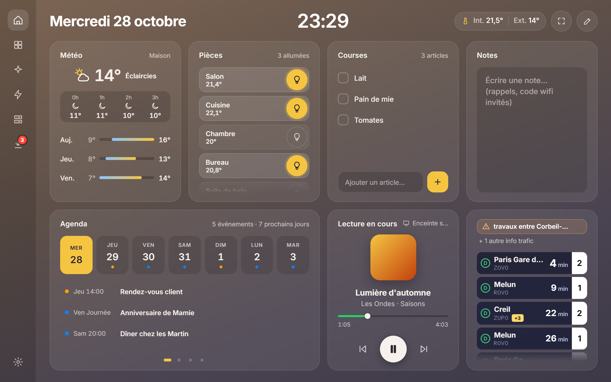
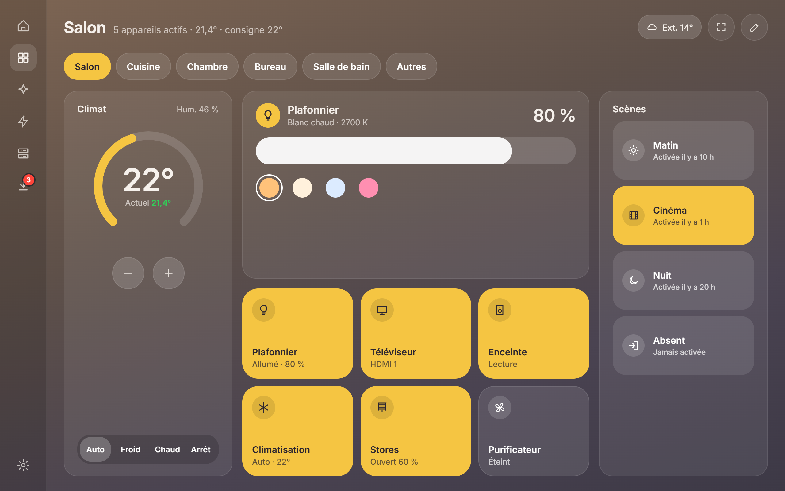
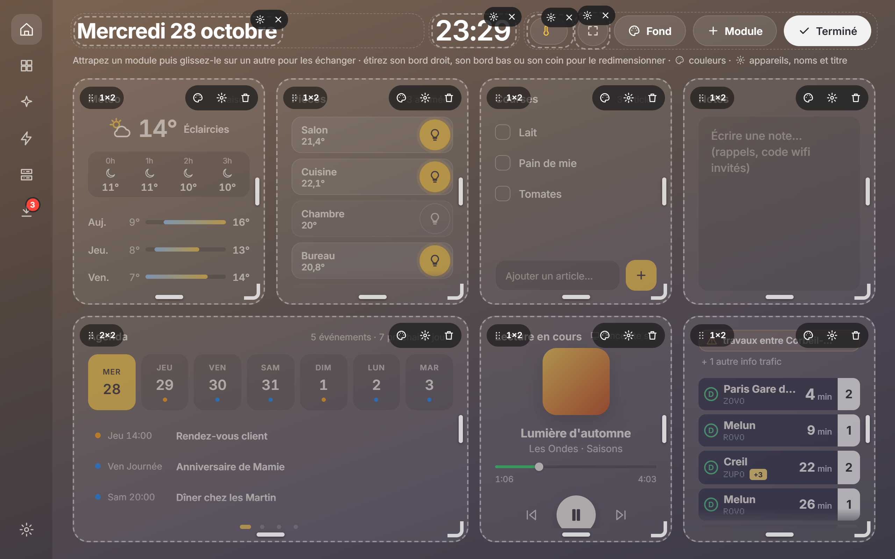
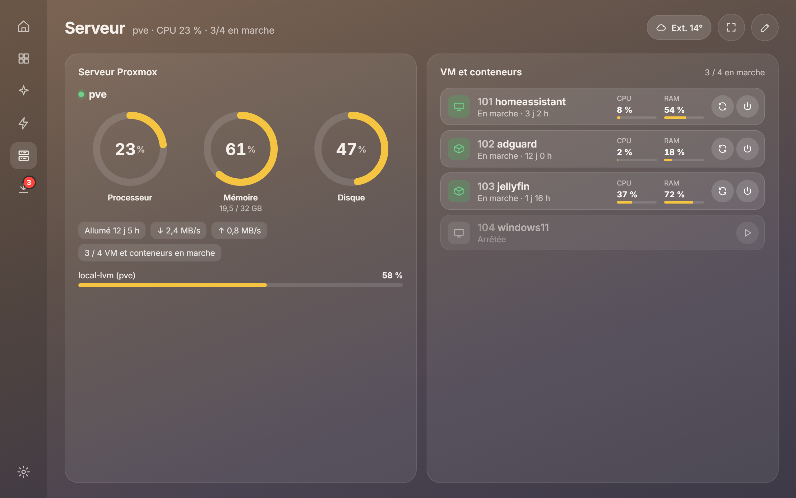
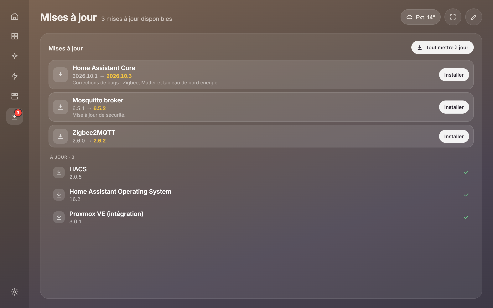

# HomeBoard

**Un tableau de bord Home Assistant pour tablette murale, au style verre dépoli inspiré de visionOS.**

Une appli web sans compilation (HTML, CSS et JavaScript), qui se connecte directement à Home Assistant
par son API WebSocket et construit l'interface à partir des appareils qu'elle trouve.



## Points forts

- **Rien à installer ni à compiler** : trois fichiers à copier dans Home Assistant, ou servis en local.
- **Interface générée toute seule** : pièces, lumières, thermostats, scènes… apparaissent sans configuration.
- **Entièrement personnalisable** : grille de 4 × 4, modules à déplacer et à étirer, et chaque module a une mise en page propre à chaque taille, de 1×1 à 4×4.
- **Pensé pour une tablette murale** : plein écran, gros boutons, reconnexion automatique, et l'écran n'est redessiné que là où quelque chose change.
- **Disposition enregistrée dans le compte Home Assistant** : elle suit sur tous les écrans.
- **Mode démo** pour l'essayer sans serveur.

## Aperçu

| Pièce | Personnalisation |
|---|---|
|  |  |
| **Serveur Proxmox** | **Mises à jour** |
|  |  |

## Démarrage rapide

### Servie par Home Assistant (recommandé)

1. Copiez `index.html`, `styles.css` et le dossier `js/` dans `/config/www/maison/`.
2. Ouvrez `http://<votre-ha>:8123/local/maison/index.html`.
3. Facultatif : ajoutez la page à la barre latérale (Paramètres › Tableaux de bord › Ajouter › Page web).

Servie depuis Home Assistant, la page se connecte avec votre session HA, sans jeton.

### En local

```bash
python -m http.server 8080
```

Puis ouvrez http://localhost:8080. Le bouton **Essayer la démo** lance des données fictives.

### Connexion par jeton

- **Adresse** : par exemple `http://homeassistant.local:8123`.
- **Jeton** : dans Home Assistant, votre profil › Sécurité › *Jetons d'accès longue durée* › Créer.
  Utilisez un compte **administrateur**, sinon les pièces (zones) ne sont pas lues.
- Le jeton reste dans le `localStorage` de ce navigateur.
- Une page en HTTPS ne peut pas joindre un Home Assistant en HTTP : le navigateur le bloque.

## L'écran d'accueil

Il est conçu pour remplir exactement l'écran d'une tablette :

- **Météo** : conditions actuelles, prochaines heures et jours suivants ; un toucher ouvre le détail.
- **Pièces** : température, lumières allumées, une ampoule par pièce pour tout allumer ou éteindre.
- **Courses** : liste à cocher, ou liée à une liste Home Assistant (par exemple **Bring!**, partagée avec les téléphones et mise à jour en direct).
- **Notes** : un mémo libre.
- **Agenda** : les prochains jours de vos calendriers, à faire défiler semaine par semaine.
- **Lecture en cours** : Spotify ou un autre lecteur (pochette, commandes, enceinte, volume, playlists).
- **Départs RER** : un tableau des prochains départs (mission, minutes, voie, retards, changements de voie) et les infos trafic.

**En-tête** : date, heure, températures, lampes allumées, plein écran… répartis en trois zones,
avec 11 styles de police. Un module glissé dans l'en-tête passe en version compacte.

**Fond d'écran** : fonds prêts, couleur au choix ou photo, avec un réglage d'assombrissement.

## Personnaliser

Touchez le crayon en haut à droite de n'importe quelle page :

- **+ Module** : ajoutez un module ; le nombre d'appareils compatibles est indiqué.
- **Déplacer** : maintenez un module (ou sa poignée ⠿), puis lâchez-le sur un autre pour échanger leurs places.
- **Redimensionner** : étirez le bord droit, le bord bas ou le coin ; la taille s'aligne sur la grille en direct.
- **⚙** : titre, portée (*cette pièce* ou *toute la maison*), appareils affichés, couleur d'accent, renommage des appareils.
- Au clavier : flèches sur la poignée (déplacer) ou sur un bord (taille).

Tant qu'une page n'a pas été modifiée, sa disposition est générée automatiquement et les nouveaux
appareils y apparaissent d'eux-mêmes.

## Modules

| Module | Contenu |
|---|---|
| **Températures** | thermomètres avec l'humidité, par capteur ou en moyenne par pièce, couleurs selon des seuils réglables |
| **Thermostat** | `climate.*` : consigne, modes, humidité ; cadran en grand, compact en petit |
| **Éclairage** | `light.*` : intensité et teintes selon ce que la lampe sait faire |
| **Appareils** | prises, volets, serrures, médias, ventilateurs, aspirateurs, capteurs de sécurité… |
| **Capteurs** | n'importe quelle valeur (CO₂, luminosité, batterie…) |
| **Scènes** | `scene.*` de la pièce ou de la maison |
| **Énergie** | capteurs de puissance et de consommation |
| **Météo** | `weather.*` : conditions, prévisions, détail au toucher |
| **Calendrier** | `calendar.*` (Google, iCal, local…) : affichages Compact, Liste, Détaillé, Semaine et Jours |
| **Courses** | liste locale ou liste de tâches Home Assistant (Bring!) |
| **Départs train / RER** | départs en temps réel Île-de-France Mobilités : mission, minutes, voie, retards, suppressions, changements de voie, perturbations |
| **Caméra** | image en direct (flux MJPEG de HA), plein écran au toucher, mode « une image toutes les 10 s » |
| **Spotify / musique** | `media_player` : pochette, commandes, volume, enceinte Spotify Connect, playlists |
| **Notes** | mémo enregistré dans votre compte Home Assistant |
| **Automatisations** | activer ou désactiver `automation.*`, lancer `script.*` |
| **Pièces** | résumé de chaque pièce ; un toucher l'ouvre |
| **Mises à jour** | entités `update.*` : notes de version, installation avec sauvegarde, « Tout mettre à jour » |
| **Serveur Proxmox** | processeur, mémoire, disque, réseau, stockages du nœud |
| **VM et conteneurs** | état, CPU et RAM ; démarrer, éteindre, redémarrer (avec confirmation) |

Les entités masquées, désactivées ou de catégorie *config* / *diagnostic* sont ignorées.

## Intégrations

### Départs RER (Île-de-France Mobilités)

Deux sources possibles :

- l'intégration HACS **« Ile de France Mobilités »** : ses capteurs de départ sont regroupés, son capteur « problème » donne la perturbation en cours ;
- ou un capteur REST sur l'API PRIM : voir [`homeassistant/rer_d_le_mee.yaml`](homeassistant/rer_d_le_mee.yaml) (jeton gratuit, 1 000 requêtes par jour).

Les événements « RER D : … » ou « Ligne D : … » de vos calendriers s'affichent comme infos trafic
et sont masqués des agendas.

### Spotify

Le tableau de bord passe par l'intégration Spotify de Home Assistant :

1. Sur developer.spotify.com › Dashboard › *Create app*, mettez l'URI de redirection
   `https://my.home-assistant.io/redirect/oauth` et choisissez *Web API*.
2. Dans Home Assistant › Paramètres › Appareils et services › Ajouter une intégration › **Spotify**,
   collez le *Client ID* et le *Client secret*, puis connectez votre compte (Premium requis pour piloter la lecture).
3. Ajoutez le module **Spotify / musique**.

### Proxmox

Installez l'intégration **Proxmox VE** (HACS) avec un utilisateur API Proxmox. Chaque nœud, VM,
conteneur et stockage devient un appareil, affiché sur la page **Serveur**.

## Réglages

- Ordre et visibilité des pièces.
- Source de la température extérieure : automatique, un capteur précis, ou rien.
- Disposition : enregistrée dans le compte Home Assistant, avec export et import en JSON.
- Couleur d'accent, liste des appareils trouvés, connexion.

## Déploiement automatique

Le dossier `deploy/` contient un exemple de publication par `git push` :

- un hook côté serveur lance des contrôles JavaScript puis `deploy/deploy.sh` ;
- `deploy.sh` copie les fichiers dans `/config/www/maison` de la VM Home Assistant (via Proxmox), garde les 5 dernières versions et vérifie chaque fichier servi ;
- `deploy/deploy.sh --rollback` remet la version précédente ;
- `publier.cmd` (Windows) fait le commit et le push en un double-clic.

**Cache** : Home Assistant sert `/local` avec un cache de 31 jours. Laissez `?v=dev` dans les sources :
`deploy.sh` le remplace par l'empreinte du contenu et publie `version.json`. Au chargement, la page
vérifie cette version et se recharge si une plus récente existe.

## Structure du code

| Fichier | Rôle |
|---|---|
| `js/ha.js` | client WebSocket : authentification, registres, événements, appels de service, reconnexion |
| `js/auth.js` | connexion avec la session Home Assistant ou par jeton |
| `js/model.js` | pièces, appareils, libellés d'état en français |
| `js/modules.js` | catalogue des modules : ce qu'ils acceptent et comment ils s'affichent |
| `js/layout.js` | disposition : sauvegarde, dispositions automatiques, choix des entités |
| `js/app.js` | pages, mode personnalisation, fenêtres de réglage, actions |
| `js/morph.js` | mise à jour de la page sur place, sans tout redessiner |
| `js/demo.js` | faux serveur pour le mode démo |
| `js/icons.js` | icônes |
| `styles.css` | styles « verre » |
